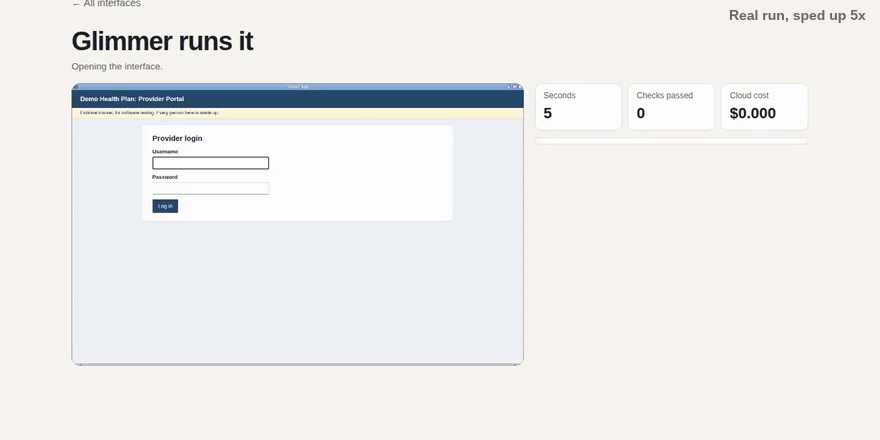
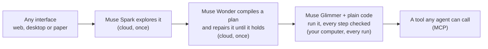

# Autoharness

**Any interface, compiled for a small model.**

Point it at an app made for people, and describe a job in plain words. One of Meta's frontier models learns the job once, by using the app. From then on, the job is a tool any AI agent can call. A small open model does the work on your own computer, and code checks every step.



<sub>A real run: Muse Glimmer on four 16 GB GPUs filling a made-up insurer's five-step form. Each line on the right is a check that passed. Cloud cost: $0.</sub>

| | A computer-use agent today | With Autoharness |
|---|---|---|
| **Who works the screen** | A frontier model, looking at a screenshot at almost every step | A frontier model once, to learn the job. Then a small open model on your computer |
| **Cloud cost** | Every run: $0.009 to $0.17 per job here, with Muse Spark | Teaching, once: $0.12 to about $4. Each run: $0 |
| **Your screen** | Sent to the cloud at each step | Stays on your computer |
| **What an agent calls** | click, type, scroll | `orders__read_order(order_number)` |
| **When something doesn't match** | The model decides on the spot | It stops and says what it couldn't find |

> **The finding.** One small model, one job: reading a patient's chart in OpenEMR, a real medical-records system, with made-up patients. When Glimmer was given the whole job, it went **0 for 6**. When the job was compiled, it went **5 for 5** on patients it had never seen. The model was the same both times. The only change was that a frontier model did the thinking in advance.

## Try it in three commands

```bash
autoharness up      # starts the app and two made-up demo apps, then checks what's ready
autoharness teach http://127.0.0.1:8320/admin/ "Log in with username manager and password demo-pass. Open order ORD-10530 and report its status and tracking number." --name orders
autoharness call orders__read_order order_number=ORD-26616
```

Real output, shortened ([full transcript](docs/agent/5-taught-from-the-terminal.txt)):

```text
$ autoharness teach http://127.0.0.1:8320/admin/ "Log in with username manager and password demo-pass. Open order ..." --name orders
Muse Spark is using the interface for the first time.
  Spark Orders are listed, so I'll search for ORD-10530.
  Spark Order ORD-10530: Status = Shipped, Tracking number = TRK942213
Muse Wonder is writing the plan.
Muse Glimmer is running the plan on its own.
  ✓ Glimmer's run 1: passed (34 s)

Learned, for $0.14, once. It's now a tool any agent can call:
  autoharness call orders__read_order order_number=ORD-10530

$ autoharness call orders__read_order order_number=ORD-26616
Muse Glimmer is running the plan, with no cloud.
  ✓ check    Is the results table showing a row whose NUMBER column reads ORD-26616?
  ✓ click    the blue order-number link reading ORD-26616 in the NUMBER column, the first data column, of th…
  ✓ read     order
  ✓ compare  ORD-26616 / ORD-26616
  …
✓ Verified in 22 s, 26 checks, $0 in the cloud
{"order": {"number": "ORD-26616", "customer": "Priscilla Tovar", "status": "Shipped", "tracking": "TRK953690"}}
```

It was taught on one order and read another, and the answer matches the database. The login went into `~/.autoharness/logins.json` on this computer, not into the tool. Every job can be watched live at `http://127.0.0.1:4140`. First time? See [Install](#install).

## Plug it into any agent

Every job is a tool over MCP, the standard way AI agents use tools. `autoharness connect` prints these settings with your paths filled in.

| Your agent | Add this |
|---|---|
| Muse Spark, from this repo | `python scripts/ask.py "Has order ORD-10530 shipped?"` |
| A client that connects to an address | `http://127.0.0.1:4140/mcp/ui` |
| A client that starts a command, like Claude Desktop or Cursor | `{"mcpServers": {"autoharness": {"command": "/path/to/autoharness", "args": ["mcp"]}}}` |
| Claude Code | `claude mcp add autoharness -- /path/to/autoharness mcp` |

- **The agent gets back only verified results.** It never sees your screen, and never a kept login.
- **A bad call is refused before anything opens:** a missing input, an unexpected one, or a call made while Glimmer isn't running.
- **Long jobs work with any client.** Jobs take 15 s to a few minutes, and most clients give up on a call after 60 s. So a call still running at 50 s answers with a job id, the job keeps going, and the agent collects the result with `wait_for_job`.
- **Both ways in were tested** with the official MCP Python SDK, on real jobs.

## Why

Nearly every interface was built for human eyes and hands: records systems, insurer portals, back offices, desktop apps. Nobody is going to rebuild them all for AI. Today's agents work around this by sending a frontier model a screenshot at almost every step. That's slow, it costs money on every run, and everything on your screen goes to the cloud.

Autoharness uses computer use as a compiler, not a runtime. A frontier model works the interface out once, and a small model runs what it compiled, as often as needed. Every interface gets a version made for models, without anyone writing one: by the models, for the models.

## How it works



| Step | Who | What happens | Where |
|---|---|---|---|
| **Explore** | Muse Spark | Uses the interface once, through computer use. Everything it sees and does is recorded | Cloud, once |
| **Compile** | Muse Wonder | Turns the record into a plan made of small, general skills, with every decision made in advance | Cloud, once |
| **Prove and repair** | Glimmer, then Wonder | Glimmer has to run the plan alone. Each failure goes back to Wonder with its screenshots | Cloud, once |
| **Run** | Muse Glimmer and plain code | Code walks the plan and holds all the memory. Glimmer answers one narrow question per screen | Your computer |
| **Call** | Any agent | Each job is a tool over MCP. The caller gets only verified results back | Your computer |

The key to making a small model reliable is to never ask it to plan or remember. Given a whole job and a screenshot, Glimmer gets lost. Given one narrow question at a time, like *where is the Save button?*, *is this the Review page?* or *what does this box say?*, it's fast and accurate. So Wonder does all the deciding ahead of time, and the plan it writes is data, not code:

```json
[{"do": "ensure", "question": "Is 'Medical Issues' heading showing?"},
 {"do": "read_list", "into": "medication_rows", "item": {"title": "the blue linked medication title text", "status": "the status word in parentheses"}, "where": "Only rows under the 'Medications' heading", "scroll": 3},
 {"do": "for_each", "list": "{medication_rows}", "as": "row", "steps": [
   {"do": "click", "target": "the small '>' expand arrow at the far left of the medication row titled '{row.title}'"},
   {"do": "read", "into": "medication_detail", "fields": {"start": "the date on the start date line in the expanded detail block"}, "types": {"start": "date"}}]}]
```

## Measured

Every job below ran on inputs that weren't used in teaching. Each result was checked against the app's own data, never the run's own claim. Pass bars were committed to git before the first run.

<!-- proof -->
| Job | Glimmer + compiled plan | Median time | Cloud per run | Muse Spark, a screenshot every step |
|---|---|---|---|---|
| A made-up insurer's portal: fill and save a five-step request | **5/5** | 157 s | $0 | 3/3, 556 s, $0.172 |
| OpenEMR: find a patient, read their birth date | **5/5** | 47 s | $0 | 3/3, 84 s, $0.036 |
| OpenEMR: change a patient's phone number | **5/5** | 76 s | $0 | 3/3, 293 s, $0.095 |
| OpenEMR: read a whole chart | **5/5** | 205 s | $0 | 3/3, 218 s, $0.091 |
| Django admin: mark an order shipped | **5/5** | 72 s | $0 | 3/3, 74 s, $0.024 |
| Django admin: read an order | **5/5** | 32 s | $0 | 3/3, 52 s, $0.016 |
| GNOME Calculator, a native desktop app | **5/5** | 15 s | $0 | 3/3, 24 s, $0.009 |
<!-- /proof -->

- **35 of 35** runs on the final code, across four very different interfaces, and **none saved a wrong result**.
- **No cloud at run time.** With the Meta API unreachable, the calculator and portal jobs still passed and the spend ledger didn't move.
- **Teaching is cheap and happens once:** from $0.12 for the calculator to about $4 for OpenEMR, including repairs that didn't work. Three new jobs on the Django admin were each learned from the app's own screen in 2 to 4 minutes, for $0.13 to $0.15 each.
- **Earlier rounds failed, and they're all kept.** Every round is in [docs/PROOF.md](docs/PROOF.md), including the ones that missed the bar.

## Two apps with no API, joined by an agent

Here Muse Spark is the agent, in a real run from [`scripts/ask.py`](scripts/ask.py). It reads a chart in one system and files a request in another. Neither has an API, and no connector was written by hand. Outputs are shortened:

```text
You: Renata Ashby needs a prior authorization for vortioxetine 10 mg, 30 tablets for 30 days.
     Her chart is in OpenEMR. Read it, then file the request in the insurer's portal.

muse-spark-1.3 calls openemr-chart__read_patient_chart {"first": "Renata", "last": "Ashby"}
  verified in 142 s: {"identity": {"member_id": "MBR-20863", "dob": "1983-05-14"}, "problems": [{"title": "Major depressive disorder,
                     recurrent, moderate", "code": "F33.1", "status": "Active"}], "medication_rows": [...], ...}

muse-spark-1.3 calls portal__save_request {"member_id": "MBR-20863", "dob": "1983-05-14", "drug": "vortioxetine", "strength": "10 mg",
                                           "quantity": 30, "days": 30, "icd10": "F33.1", "trials": [...]}
  verified in 159 s: {"member_on_medication": {"member_name": "Renata Ashby"}, "med_readback": {"drug": "Vortioxetine", "strength": "10 mg",
                     "quantity": "30", "days": "30"}, "added_treatments": [...], ...}

muse-spark-1.3: Chart read for Renata Ashby: MBR-20863, DOB 1983-05-14, F33.1, with prior Sertraline (inadequate response)
and Bupropion XL (intolerance).

Prior auth filed and saved as PA-837691, Awaiting prescriber signature for Vortioxetine 10 mg, 30 / 30 days.
Stopped for prescriber to sign.

The asking model cost $0.0161 in the cloud. The interface ran on this computer, for $0.
```

Every field in the saved request matches the made-up chart. The small model did all the screen work, and the frontier model spent under two cents choosing jobs and inputs.

The agent's mistakes end in a stop, not a wrong save. On this run Spark first passed `"Renata Ashby"` as the first name. The plan didn't open the closest-looking patient: it stopped and said the exact name wasn't in the results, and Spark tried again correctly. On an earlier run, Spark sent `30.0` as a quantity, and the portal job stopped before saving anything. Whole numbers are now passed on as whole numbers.

A missing job is one command away. In the first agent run, Spark was asked whether an order had shipped, and said plainly that no job could tell it. The `teach` command above taught that job, and asked again, Spark answered "Yes — ORD-10530 has shipped. Tracking: TRK942213." All five agent runs, including the failures, are in [docs/AGENT.md](docs/AGENT.md).

## No silent errors

No model can promise to be error-free. Instead, the code enforces these rules, and `tests/test_uiteam.py` and `tests/test_team.py` check them:

- **Everything typed is read back** from a close-up of the box that was clicked. A mismatch gets one retry, then the run stops.
- **Everything read is read twice**, from two different views of the screen. If the reads disagree, there's one more look.
- **Before changing a record**, it reads who the record belongs to and compares that in plain code.
- **If it can't find something, it stops** rather than clicking somewhere nearby.
- **Anything only a person may do**, like signing, is a hard stop in the plan. The demo portal also enforces this on its server.

## Paperwork is an interface too

A stack of pages is a read-only interface, so the same idea applies. Wonder looks at one sample and writes a reading plan. Glimmer reads every page. Plain code merges the reads, compares the pages with each other, and sends every gap or contradiction to a person, side by side. Approved values then go into a compiled interface, so nobody writes a connector by hand.

I'm a psychiatrist, and this is the part of my week I'd like back. In the demo, a medication request where one page has a member ID off by one digit comes to me with both versions side by side. A clean stack fills the insurer's portal and stops at the signature.

On three unseen sets of made-up packets, it saved nothing wrong and caught 35 of 36 planted errors. The pages are typed scans, handwriting-style fonts, and simulated faxes and phone photos. They aren't real faxes or real handwriting. Full results are in [docs/PROOF.md](docs/PROOF.md).

## A swarm, on one small model

Each copy of the interface gets its own screen and its own memory, so several jobs can share one served Glimmer without mixing each other up. It works, but on my hardware it barely adds speed. One job already nearly fills what four 16 GB GPUs can serve, and reads level off at about 8 at once.

<!-- swarm -->
| At once | Finished and verified | Wrong saved | Time for all | Jobs an hour |
|---|---|---|---|---|
| 1 | 5/5 | 0 | 610 s in a row | 30 |
| 4 | 4/4 | 0 | 411 s | 35 |
| 8 | 6/8 | 0 | 630 s | 34 |
<!-- /swarm -->

## Honest answers

**Why not just use Muse Spark?** For one-off or unfamiliar jobs, do. Spark passed every job here too, and on small jobs it costs only cents. A plan only knows what it was taught. The compiled route is for work that repeats, runs long, or can't leave your machine. For that work, a small open model matched the frontier model's pass rate with no cloud at all. On the portal it was also 3.5 times faster: 157 s against 556 s. Teaching the portal cost $1.34 once, against $0.17 for each Spark run, so it pays for itself in about 8 runs.

**Couldn't this just be a markdown skill?** On simple form apps, largely. A written guide took Glimmer to 5 of 5 on registering a patient in OpenEMR. But guides went 0 of 6 on reading a chart, because a guide still asks the small model to plan and remember. A plan doesn't.

**Does it replace computer use?** No. Computer use is how it learns. What changes is that a frontier model only has to work out each job once.

**What if the app changes?** The run stops and says what it couldn't find. It doesn't click somewhere nearby. You then teach that job again.

## What failed

Keeping these is the point. Every run is in the logs.

- Patching a plan again and again made it worse. The chart plan bloated, overfit to one patient, and went 0 of 5 on new ones. Recompiling it and teaching on several patients fixed that.
- The first paperwork test failed its bar with a wrong save. My own code had skipped a date check whenever a date couldn't be parsed.
- One blank answer slot in my prompt made one-field reads come back empty 11 times in 15. It looked like random failures until I measured it.
- Rental applications still fail their bar: a missing employment date got through, because Wonder marked that field optional.
- More readers per page mattered less than I expected. On unseen paperwork, one reader did about as well as a team of four in half the time.
- My first design generated a Python harness with OCR. Its medication-request programs went 0 of 2. It's still in the repo as Program mode.

## Limits

- It isn't ready for real patients or real records. Nothing here has had clinical or legal review, and all test data is made up.
- Every app was tested on one Linux machine, and the samples are small.
- Teaching sends screenshots to Meta's API, so don't teach it on real records. Runs don't send anything.
- A plan can't do a job that needs real reasoning at every step, like a game. For those, Program mode generates a program instead, and it went 5 of 5 on Minesweeper where guides went 0 of 3 ([docs/BENCHMARK.md](docs/BENCHMARK.md)).
- Real handwriting, real faxes and a real network-cable pull are untested.

## Install

You need:

- **Linux with Python 3.11 or newer.** Jobs run on a virtual screen, so they never touch yours.
- **Room for Muse Glimmer:** 24.7 GB of open weights, on Blackwell GPUs. I use four 16 GB RTX 5060 Ti. Or point `GLIMMER_URL` at any OpenAI-compatible server that already runs Glimmer.
- **A Meta API key, only to teach** new interfaces. Running a compiled job needs no key and no internet.

```bash
git clone https://github.com/adaptabyte/autoharness && cd autoharness
python3 -m venv .venv-app && .venv-app/bin/pip install -e '.[demo]'
source .venv-app/bin/activate
bash scripts/setup_desktop.sh      # the virtual screen and a browser, no root needed
cp .env.example .env               # add MODEL_API_KEY to teach; nothing else needs it

# Muse Glimmer, once: vLLM in its own environment, and the weights
python3 -m venv .venv && .venv/bin/pip install vllm==0.32.0 huggingface_hub
.venv/bin/hf download nvidia/Muse-Glimmer-30B-NVFP4 --local-dir models/Muse-Glimmer-30B-NVFP4

autoharness up                     # starts Glimmer too; it takes a few minutes to load
autoharness check                  # run again until everything is ready
```

`serve/serve_glimmer.sh` picks the GPUs itself: up to four Blackwell cards with room, and it never stops anything else to make room. `bash serve/serve_glimmer.sh --dry-run` shows what it would do.

| Command | What it does |
|---|---|
| `autoharness up` | Starts the app, the made-up demo apps and Glimmer, if they aren't running, then checks everything |
| `autoharness check` | What's ready, what's missing, and the fix for each |
| `autoharness teach <address> "<job>"` | Teaches a new job, in plain words. `--name` names the interface |
| `autoharness tools` | Every job an agent can call, with its inputs |
| `autoharness call <tool> key=value ...` | Runs one job and prints the verified result |
| `autoharness connect` | Settings for MCP clients, with your paths filled in |
| `autoharness mcp` | The MCP server on stdin and stdout, for clients that start a command |
| `autoharness down` | Stops what `up` started |

Everything also works in the web app at `http://127.0.0.1:4140`.

- **Spending:** `AUTOHARNESS_BUDGET` is a hard cap on Meta API spend, enforced in code.
- **Test apps:** the made-up portal and Django admin start with `up`. OpenEMR runs in Docker: see `scripts/openemr`.
- **Reproducing results:** use `scripts/uiteam/run.py` and `scripts/paperwork/evaluate.py`. `scripts/report.py` rebuilds every table from the raw logs.
- **Tests:** `python -m pytest tests/`.

## Built with Meta's models

| Model | Role |
|---|---|
| **Muse Spark 1.3** | Explores each interface through computer use, and judges the final screen when teaching. It's also the example agent in `scripts/ask.py` |
| **Muse Wonder 1.0** | Compiles what Spark did into a plan, repairs the plan from failed runs, and designs reading plans for new paperwork |
| **Muse Glimmer**, open weights | Runs everything at run time on my own GPUs through vLLM, with no cloud |

## How this was built

Built during the Meta Global AI Developer Hackathon by one person, a psychiatrist, directing Claude Code, which wrote most of the code. The idea, the product decisions and the direction are mine. All the code in this repo was written during the event. Meta's models power the product, and no Claude model runs in it.
