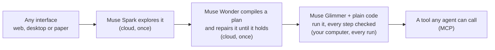

# Autoharness

**Any interface, compiled for a small model.**

Point it at an app made for people, on this computer or any other, and describe a job in plain words. One of Meta's frontier models learns the job once, by using the app. From then on, the job is a tool any AI agent can call. A small open model does the work on your own computer, and code checks every step.


<sub>A real run: Muse Glimmer on four 16 GB GPUs filling a made-up insurer's five-step form. Each line on the right is a check that passed. Cloud cost: $0.</sub>

| | A computer-use agent today | With Autoharness |
|---|---|---|
| **Who works the screen** | A frontier model, looking at a screenshot at almost every step | A frontier model once, to learn the job. Then a small open model on your computer |
| **Cloud cost** | Every run: $0.009 to $0.17 per job here, with Muse Spark | Teaching, once: $0.12 to about $4. Each run: $0 |
| **Your screen** | Sent to the cloud at each step | Stays on your computer |
| **What an agent calls** | click, type, scroll | `orders__read_order(order_number)` |
| **When something doesn't match** | The model decides on the spot | It stops and says what it couldn't find |

> **The finding.** One small model, one job: reading a patient's chart in OpenEMR, a real medical-records system, with made-up patients. When Glimmer was given the whole job, it went **0 for 6**. When the job was compiled, it went **5 for 5** on patients it had never seen. The model was the same both times. The only change was that a frontier model did the thinking in advance.

**Judges:** a live copy runs at [demo.adaptabyte.com](https://demo.adaptabyte.com). The sign-in is in the submission. Run anything it already learned for free, or point it at a public website and watch it learn ([how it's kept safe](#the-live-demo)).

## Try it in three commands

```bash
autoharness up      # starts the app and two made-up demo apps, then checks what's ready
autoharness teach http://127.0.0.1:8320/admin/ "Log in with username manager and password demo-pass. Open order ORD-10530 and report its status and tracking number." --name orders
autoharness call orders__read_order order_number=ORD-26616
```

Real output, shortened ([full transcript](docs/agent/5-taught-from-the-terminal.txt)):

```text
$ autoharness teach http://127.0.0.1:8320/admin/ "Log in with username manager and password demo-pass. Open order ..." --name orders
Muse Spark is using the interface for the first time.
  Spark Orders are listed, so I'll search for ORD-10530.
  Spark Order ORD-10530: Status = Shipped, Tracking number = TRK942213
Muse Wonder is writing the plan.
Muse Glimmer is running the plan on its own.
  ✓ Glimmer's run 1: passed (34 s)

Learned, for $0.14, once. It's now a tool any agent can call:
  autoharness call orders__read_order order_number=ORD-10530

$ autoharness call orders__read_order order_number=ORD-26616
Muse Glimmer is running the plan, with no cloud.
  ✓ check    Is the results table showing a row whose NUMBER column reads ORD-26616?
  ✓ click    the blue order-number link reading ORD-26616 in the NUMBER column, the first data column, of th…
  ✓ read     order
  ✓ compare  ORD-26616 / ORD-26616
  …
✓ Verified in 22 s, 26 checks, $0 in the cloud
{"order": {"number": "ORD-26616", "customer": "Priscilla Tovar", "status": "Shipped", "tracking": "TRK953690"}}
```

It was taught on one order and read another, and the answer matches the database. The login went into `~/.autoharness/logins.json` on this computer, not into the tool. Every job can be watched live at `http://127.0.0.1:4140`. First time? See [Install](#install).

## Use it on your own app

Same command for any app. Only the address changes.

| Your app | The address to teach |
|---|---|
| A website or web app | its web address: `https://...` |
| A desktop app on Linux | its command: `gnome-calculator` |
| Anything on another computer: a Windows or Mac app, a game, a virtual machine | `vnc://that-computer`, once its screen sharing is on ([how](#turn-on-screen-sharing)) |

You don't pick how it's learned. Spark reads the job and picks:

- **A plan** when the same steps work every time: look up an order, fill in a form, export a report, buy something in a game's shop. Glimmer runs it, and code checks every step.
- **A program** when each move depends on what's on the screen: win a game, solve a puzzle. Muse Wonder writes code for that app, and the code has to do the whole job on its own, five times, before it's offered.

Either way, the result is a tool that `autoharness call` and any MCP agent use the same way.

### Give it the manual

Spark doesn't have to find every control by trying it. Hand over whatever explains the app, and Muse Wonder reads it all before anything touches the app:

```bash
autoharness teach gnome-robots "Clear the first level of Robots ..." --docs https://help.gnome.org/users/gnome-robots/stable/
autoharness teach vnc://gamepc "Buy a health potion in the shop" --docs manual.pdf controls.png
```

`--docs` takes PDFs, pictures, web pages, Word files, text files, and folders of them. A help site's front page brings the pages it lists. Wonder writes Spark a short brief: the controls, how the docs say the job is done, and what to check on the screen first. Wonder gets the brief again when it writes the plan or program, beside what Spark actually saw.

The docs are never taken on trust. They may describe another version of the app, so the screen wins wherever the two disagree. The plan or program still has to pass its runs on its own.

Tried on GNOME Robots, whose keys can't be guessed: y, k, u, h, l, b, j and n move you, the old Unix layout. Wonder read the 8-page help site for $0.05, and its first check for Spark was whether those keys move the character. Spark checked them in the game's settings and on the board. The program Wonder wrote moves with exactly those keys, and it cleared level 1 in five of five runs on its own. The lesson cost $1.64. One later pass, to stop waiting out the game's animation, made each run about four times faster and cost $0.32 more ([transcript](docs/agent/8-reading-the-manual.txt)). There's no run without the docs to compare, so this shows the docs were used, not that they saved money.

### Example: a game on another computer

GNOME Mines, open on another screen shared over VNC by x11vnc, a standard VNC server. It was left showing a game already won. Nothing told Autoharness it was a game. Real output, shortened ([full transcript](docs/agent/7-a-game-on-another-computer.txt)):

```text
$ autoharness teach "vnc://:playtime@127.0.0.1:5912" "Win a game of Minesweeper on the 8 x 8 board. ..." --name mines
Spark Each move depends on the revealed numbers so it must react to the board.
So it learns this as a program: code that decides each move, written once by Muse Wonder.
Muse Spark is using the interface for the first time.
  Spark That results screen is blocking the board — I'll try to clear it.
  Spark I've seen how losing works — now I'll check the remaining controls.
Muse Wonder is writing the program and trying it.
  ✓ Wonder wrote the program, version 2: 800 lines.
  ✓ On its own, run 1 of 5: passed (35 s). Final Congratulations table shows a new 26-second rank-4 entry absent at start, …
  …
  ✓ On its own, run 5 of 5: passed (22 s). Final screen shows a new 12-second best score not present at start, proving a fresh win.

Learned, for $1.24, once. It's now a tool any agent can call:
  autoharness call mines__win_minesweeper

$ autoharness call mines__win_minesweeper
The program is doing the job, with Muse Glimmer for any look it needs. No cloud.
✓ Verified in 32 s, checked on screen, $0 in the cloud
{"summary": "Won an 8x8 Minesweeper game after 1 game(s) in this run; win is visible on screen.", "games_played": 1}
```

Taught once in 19 minutes. Then it won five of five fresh games on its own, and two more as a tool, one through the official MCP SDK. No second computer? `python scripts/vnc_box.py gnome-mines` opens an app on a screen shared over VNC, standing in for one.

### Apps on Windows, a Mac, or another computer

Autoharness runs on one Linux computer, the one with the GPUs for Glimmer. The app can be on any computer it can reach. It works that computer's screen over VNC, the screen-sharing standard Windows, Mac and Linux all speak, and nothing of Autoharness is installed there. Turn sharing on once:

| That computer | Turn on screen sharing |
|---|---|
| **Mac** | Built in. System Settings → General → Sharing → Screen Sharing → ⓘ → turn on "VNC viewers may control screen with password" |
| **Windows** | Install [TightVNC](https://www.tightvnc.com), which is free, and set a password when it asks. For games, use windowed or borderless mode: some full-screen games show black to any screen sharing |
| **Linux** | `x11vnc -usepw -forever -shared` on an X11 desktop, Desktop Sharing on KDE, or `wayvnc` on Sway |

Then `autoharness screens` finds them. It lists the computers on your [Tailscale](https://tailscale.com) network, says which are sharing, and gives the steps for each system that isn't. Real output, with the computers' names changed:

```text
$ autoharness screens
Other computers, from Tailscale
  · gamepc              windows  not sharing
      To share it: Install TightVNC, which is free (tightvnc.com). Choose the server, and set a password of up to 8 characters ...
  · laptop              linux    not sharing
      To share it: On an X11 desktop: x11vnc -usepw -forever -shared. KDE: turn on Desktop Sharing (krfb). ...
  · phone               iOS      Phones and tablets can't share a screen for control this way.

$ autoharness screens "vnc://:playtime@127.0.0.1:5912"
✓ vnc://127.0.0.1:5912 answers: a 1280 x 800 screen called 'adaptabyte-MC62-G40-00:2'.
  What Autoharness sees: ~/.autoharness/screens/127.0.0.1.png
```

Not on Tailscale? Use the computer's address on your network, like `vnc://192.168.1.20` or `vnc://my-mac.local`. The password goes into `~/.autoharness/logins.json` on this computer, never into a plan or a tool. A screen bigger than 1280 × 800 is scaled down for the models, and clicks are scaled back up.

**Is VNC the slow part? No.** The same app and the same action, a flag toggled 30 times in GNOME Mines, timed until the screen settled:

| | Its own virtual screen | Over VNC |
|---|---|---|
| A click that changes the screen | 409 ms | 482 ms |
| A key that changes nothing | 337 ms | 696 ms |
| Data sent | | 0.2 KB per action, 26 KB for a whole screen |

The slow part is the models: each look by Glimmer takes half a second to two seconds. VNC's extra time is deliberate. After every action Autoharness waits up to 0.3 s for the screen to answer before trusting what it sees, because a program that acted on the screen from before its own click lost games. I tried cutting that wait, and one run in three then stopped on what looked like a screen that hadn't caught up, so the wait stays. Both screens were on one machine here; a network adds its round trip, and 26 KB is about 20 ms on a 10 Mbit/s link.

Things to know:

- **It starts from whatever is showing.** On its own virtual screen, Autoharness opens a fresh copy of the app for every run. It can't on another computer. So there, Spark and Wonder are told that each run must start the job afresh, a run that does nothing can't pass, and the judge sees the screen from before the run as well as after. Teach on the screen you'll run on: a plan taught on a fresh calculator failed on one that still showed an earlier sum.
- **It moves that computer's real pointer.** Don't use that computer while a job runs on it. One job at a time per screen; a second is refused.
- **Turn-based, not twitch.** Each look takes the small model half a second to two seconds, so games that need fast reflexes are out.
- **Online games** often forbid bots in their terms. Use it on single-player games and software you're allowed to automate.
- **Tested here** against x11vnc on Linux. Tests cover the sign-in a Mac, TightVNC and others offer, but I haven't run it against a real Mac or Windows PC.

## Plug it into any agent

Every job is a tool over MCP, the standard way AI agents use tools. `autoharness connect` prints these settings with your paths filled in.

| Your agent | Add this |
|---|---|
| Muse Spark, from this repo | `python scripts/ask.py "Has order ORD-10530 shipped?"` |
| A client that connects to an address | `http://127.0.0.1:4140/mcp/ui` |
| A client that starts a command, like Claude Desktop or Cursor | `{"mcpServers": {"autoharness": {"command": "/path/to/autoharness", "args": ["mcp"]}}}` |
| Claude Code | `claude mcp add autoharness -- /path/to/autoharness mcp` |

- **The agent gets back only verified results.** It never sees your screen, and never a kept login.
- **A bad call is refused before anything opens:** a missing input, an unexpected one, or a call made while Glimmer isn't running.
- **Long jobs work with any client.** Jobs take 15 s to a few minutes, and most clients give up on a call after 60 s. So a call still running at 50 s answers with a job id, the job keeps going, and the agent collects the result with `wait_for_job`.
- **Both ways in were tested** with the official MCP Python SDK, on real jobs.

## docsdb: what it learns, shared

Every lesson leaves a guide to the app on your computer, in `~/.autoharness/guides/<app>/SKILL.md`. The guide brings together the docs you gave, what Spark checked on the real screen, and how the job is done. Each control is marked "seen on screen" or "from the docs". The next lesson on that app reads the guide first, then updates it.

With your yes, a guide joins [docsdb](https://autoharness.adaptabyte.com/docsdb/), a shared library of them:

```bash
autoharness guides                         # the guides on this computer
autoharness share gnome-robots             # shows it, asks, then offers it for review
autoharness share gnome-robots --always    # also offers later updates, each one reviewed
```

- **Anyone's lesson starts from it.** Before teaching an app, Autoharness looks for its guide in docsdb, by the app's command or public web address, and reads it like any docs. `--docs docsdb:<name>` names one outright, and `--no-guides` skips them.
- **Any agent can use it.** Each guide is an [Agent Skill](https://agentskills.io), the open format that Claude, Codex, Gemini CLI and others already load.
- **Nothing private goes in.**
  - The model that writes it never sees what was typed or read.
  - Code removes what it recognises: every value the lesson was given, emails, private addresses, file paths, keys, and numbers that look like IDs.
  - You read it before it's shared, and a person reviews it before it's live.
- **Reviewed, never automatic.** A guide becomes instructions for other people's agents, so it arrives as a pull request. A check refuses any guide with a private-looking value, HTML or script. Each guide has its full history, and the site rebuilds itself from the repo.

Other shared libraries exist for neighbouring things. [Context7](https://github.com/upstash/context7) collects code-library docs for coding agents, and llms.txt lets websites describe themselves to models. I found none for using apps through their screens.

A guide alone doesn't make a small model capable: written guides went 0 of 6 on reading a chart ([below](#honest-answers)). A guide is what the big model reads before it teaches, and it's enough for any big agent.

## The live demo

A second copy of Autoharness on the same machine, open to the internet through a Cloudflare Tunnel, behind a judge login. It shares Glimmer and the made-up demo apps, and nothing else:

- **Its own key and budget.** It has its own Meta API key, separate from mine and revocable, and a $25 cap for new lessons, at most $1.50 each, one at a time. Running anything already learned is free.
- **Only what's safe to offer.** Judges can run learned tools, watch them live, and teach new ones on public websites or a few installed games. Settings, sharing, importing and deleting are refused, as is anything not on that list.
- **Nothing private reachable.** The demo's browser and apps run in a Landlock jail, a Linux kernel feature that needs no root:
  - They can read only system files and their own fresh profile, never my home folder or any key.
  - Their only connection is a small proxy, which refuses this machine, the home network and Tailscale, except the made-up demo apps.
  - Code that Wonder writes already runs that way, in every copy, with no network at all.
- **Nothing trusted for being local.** The tunnel arrives on this machine, so the demo never trusts a request for where it comes from. Every request needs a signed-in session, and guessing passwords is cut off after eight tries.

```bash
autoharness demo setup     # its own folder, copies of what you've vetted, a judge login, its own key
autoharness demo tunnel    # once, after cloudflared tunnel login: the public address
autoharness demo up        # start it; status, down, password and key do what they say
```

## Why

Nearly every interface was built for human eyes and hands: records systems, insurer portals, back offices, desktop apps. Nobody is going to rebuild them all for AI. Today's agents work around this by sending a frontier model a screenshot at almost every step. That's slow, it costs money on every run, and everything on your screen goes to the cloud.

Autoharness uses computer use as a compiler, not a runtime. A frontier model works the interface out once, and a small model runs what it compiled, as often as needed. Every interface gets a version made for models, without anyone writing one: by the models, for the models.

## How it works



| Step | Who | What happens | Where |
|---|---|---|---|
| **Explore** | Muse Spark | Uses the interface once, through computer use. Everything it sees and does is recorded | Cloud, once |
| **Compile** | Muse Wonder | Turns the record into a plan made of small, general skills, with every decision made in advance | Cloud, once |
| **Prove and repair** | Glimmer, then Wonder | Glimmer has to run the plan alone. Each failure goes back to Wonder with its screenshots | Cloud, once |
| **Run** | Muse Glimmer and plain code | Code walks the plan and holds all the memory. Glimmer answers one narrow question per screen | Your computer |
| **Call** | Any agent | Each job is a tool over MCP. The caller gets only verified results back | Your computer |

The key to making a small model reliable is to never ask it to plan or remember. Given a whole job and a screenshot, Glimmer gets lost. Given one narrow question at a time, like *where is the Save button?*, *is this the Review page?* or *what does this box say?*, it's fast and accurate. So Wonder does all the deciding ahead of time, and the plan it writes is data, not code:

```json
[{"do": "ensure", "question": "Is 'Medical Issues' heading showing?"},
 {"do": "read_list", "into": "medication_rows", "item": {"title": "the blue linked medication title text", "status": "the status word in parentheses"}, "where": "Only rows under the 'Medications' heading", "scroll": 3},
 {"do": "for_each", "list": "{medication_rows}", "as": "row", "steps": [
   {"do": "click", "target": "the small '>' expand arrow at the far left of the medication row titled '{row.title}'"},
   {"do": "read", "into": "medication_detail", "fields": {"start": "the date on the start date line in the expanded detail block"}, "types": {"start": "date"}}]}]
```

## Measured

Every job below ran on inputs that weren't used in teaching. Each result was checked against the app's own data, never the run's own claim. Pass bars were committed to git before the first run.

<!-- proof -->
| Job | Glimmer + compiled plan | Median time | Cloud per run | Muse Spark, a screenshot every step |
|---|---|---|---|---|
| A made-up insurer's portal: fill and save a five-step request | **5/5** | 157 s | $0 | 3/3, 556 s, $0.172 |
| OpenEMR: find a patient, read their birth date | **5/5** | 47 s | $0 | 3/3, 84 s, $0.036 |
| OpenEMR: change a patient's phone number | **5/5** | 76 s | $0 | 3/3, 293 s, $0.095 |
| OpenEMR: read a whole chart | **5/5** | 205 s | $0 | 3/3, 218 s, $0.091 |
| Django admin: mark an order shipped | **5/5** | 72 s | $0 | 3/3, 74 s, $0.024 |
| Django admin: read an order | **5/5** | 32 s | $0 | 3/3, 52 s, $0.016 |
| GNOME Calculator, a native desktop app | **5/5** | 15 s | $0 | 3/3, 24 s, $0.009 |
<!-- /proof -->

- **35 of 35** runs on the final code, across four very different interfaces, and **none saved a wrong result**.
- **No cloud at run time.** With the Meta API unreachable, the calculator and portal jobs still passed and the spend ledger didn't move.
- **Teaching is cheap and happens once:** from $0.12 for the calculator to about $4 for OpenEMR, including repairs that didn't work. Three new jobs on the Django admin were each learned from the app's own screen in 2 to 4 minutes, for $0.13 to $0.15 each.
- **Earlier rounds failed, and they're all kept.** Every round is in [docs/PROOF.md](docs/PROOF.md), including the ones that missed the bar.

## Two apps with no API, joined by an agent

Here Muse Spark is the agent, in a real run from [`scripts/ask.py`](scripts/ask.py). It reads a chart in one system and files a request in another. Neither has an API, and no connector was written by hand. Outputs are shortened:

```text
You: Renata Ashby needs a prior authorization for vortioxetine 10 mg, 30 tablets for 30 days.
     Her chart is in OpenEMR. Read it, then file the request in the insurer's portal.

muse-spark-1.3 calls openemr-chart__read_patient_chart {"first": "Renata", "last": "Ashby"}
  verified in 142 s: {"identity": {"member_id": "MBR-20863", "dob": "1983-05-14"}, "problems": [{"title": "Major depressive disorder,
                     recurrent, moderate", "code": "F33.1", "status": "Active"}], "medication_rows": [...], ...}

muse-spark-1.3 calls portal__save_request {"member_id": "MBR-20863", "dob": "1983-05-14", "drug": "vortioxetine", "strength": "10 mg",
                                           "quantity": 30, "days": 30, "icd10": "F33.1", "trials": [...]}
  verified in 159 s: {"member_on_medication": {"member_name": "Renata Ashby"}, "med_readback": {"drug": "Vortioxetine", "strength": "10 mg",
                     "quantity": "30", "days": "30"}, "added_treatments": [...], ...}

muse-spark-1.3: Chart read for Renata Ashby: MBR-20863, DOB 1983-05-14, F33.1, with prior Sertraline (inadequate response)
and Bupropion XL (intolerance).

Prior auth filed and saved as PA-837691, Awaiting prescriber signature for Vortioxetine 10 mg, 30 / 30 days.
Stopped for prescriber to sign.

The asking model cost $0.0161 in the cloud. The interface ran on this computer, for $0.
```

Every field in the saved request matches the made-up chart. The small model did all the screen work, and the frontier model spent under two cents choosing jobs and inputs.

The agent's mistakes end in a stop, not a wrong save. On this run Spark first passed `"Renata Ashby"` as the first name. The plan didn't open the closest-looking patient: it stopped and said the exact name wasn't in the results, and Spark tried again correctly. On an earlier run, Spark sent `30.0` as a quantity, and the portal job stopped before saving anything. Whole numbers are now passed on as whole numbers.

A missing job is one command away. In the first agent run, Spark was asked whether an order had shipped, and said plainly that no job could tell it. The `teach` command above taught that job, and asked again, Spark answered "Yes — ORD-10530 has shipped. Tracking: TRK942213." All five agent runs, including the failures, are in [docs/AGENT.md](docs/AGENT.md).

## No silent errors

No model can promise to be error-free. Instead, the code enforces these rules, and `tests/test_uiteam.py` and `tests/test_team.py` check them:

- **Everything typed is read back** from a close-up of the box that was clicked. A mismatch gets one retry, then the run stops.
- **Everything read is read twice**, from two different views of the screen. If the reads disagree, there's one more look.
- **Before changing a record**, it reads who the record belongs to and compares that in plain code.
- **If it can't find something, it stops** rather than clicking somewhere nearby.
- **Anything only a person may do**, like signing, is a hard stop in the plan. The demo portal also enforces this on its server.

## Paperwork is an interface too

A stack of pages is a read-only interface, so the same idea applies. Wonder looks at one sample and writes a reading plan. Glimmer reads every page. Plain code merges the reads, compares the pages with each other, and sends every gap or contradiction to a person, side by side. Approved values then go into a compiled interface, so nobody writes a connector by hand.

I'm a psychiatrist, and this is the part of my week I'd like back. In the demo, a medication request where one page has a member ID off by one digit comes to me with both versions side by side. A clean stack fills the insurer's portal and stops at the signature.

On three unseen sets of made-up packets, it saved nothing wrong and caught 35 of 36 planted errors. The pages are typed scans, handwriting-style fonts, and simulated faxes and phone photos. They aren't real faxes or real handwriting. Full results are in [docs/PROOF.md](docs/PROOF.md).

## A swarm, on one small model

Each copy of the interface gets its own screen and its own memory, so several jobs can share one served Glimmer without mixing each other up. It works, but on my hardware it barely adds speed. One job already nearly fills what four 16 GB GPUs can serve, and reads level off at about 8 at once.

<!-- swarm -->
| At once | Finished and verified | Wrong saved | Time for all | Jobs an hour |
|---|---|---|---|---|
| 1 | 5/5 | 0 | 610 s in a row | 30 |
| 4 | 4/4 | 0 | 411 s | 35 |
| 8 | 6/8 | 0 | 630 s | 34 |
<!-- /swarm -->

## Honest answers

**Why not just use Muse Spark?** For one-off or unfamiliar jobs, do. Spark passed every job here too, and on small jobs it costs only cents. A plan only knows what it was taught. The compiled route is for work that repeats, runs long, or can't leave your machine. For that work, a small open model matched the frontier model's pass rate with no cloud at all. On the portal it was also 3.5 times faster: 157 s against 556 s. Teaching the portal cost $1.34 once, against $0.17 for each Spark run, so it pays for itself in about 8 runs.

**Couldn't this just be a markdown skill?** On simple form apps, largely. A written guide took Glimmer to 5 of 5 on registering a patient in OpenEMR. But guides went 0 of 6 on reading a chart, because a guide still asks the small model to plan and remember. A plan doesn't.

**Does it replace computer use?** No. Computer use is how it learns. What changes is that a frontier model only has to work out each job once.

**Isn't AutoHarness a DeepMind paper?** Yes. [AutoHarness](https://arxiv.org/abs/2603.03329), from Google DeepMind in February 2026, has a model write the code around an agent: code that refuses illegal moves in games, and sometimes the whole policy, so no model is needed at test time. The name here means the same idea, aimed at a different place: any app, through its screen. The big model learns by using the real interface, a small model runs the result on your own computer, code checks every step, and each job becomes a tool any agent can call.

**What if the app changes?** The run stops and says what it couldn't find. It doesn't click somewhere nearby. You then teach that job again.

## What failed

Keeping these is the point. Every run is in the logs.

- Patching a plan again and again made it worse. The chart plan bloated, overfit to one patient, and went 0 of 5 on new ones. Recompiling it and teaching on several patients fixed that.
- The first paperwork test failed its bar with a wrong save. My own code had skipped a date check whenever a date couldn't be parsed.
- One blank answer slot in my prompt made one-field reads come back empty 11 times in 15. It looked like random failures until I measured it.
- Rental applications still fail their bar: a missing employment date got through, because Wonder marked that field optional.
- More readers per page mattered less than I expected. On unseen paperwork, one reader did about as well as a team of four in half the time.
- On a screen that couldn't be reset, a game program "won" five times in a row, in one second each, without a single click. It had found a game it had already won while being written, and the judge, shown only the end, agreed. Now a run that does nothing can't pass there, and the judge sees how the screen looked when the run began.
- GNOME Robots never stops moving: its sprites animate, so "wait until the screen settles" ran its full 3 s after every move, and five trials ran out of time. Now `wait_stable(ignore_small=True)` settles that game in 0.26 s, and a trial tells Wonder when its waits time out this way.
- As a tool, the first Robots program cleared the level in 3 of 4 calls. The fourth ran out of time after 168 slow moves and stopped without claiming a win. One pass with the animation-tolerant wait made runs 14 to 54 s, and it passed 5 of 5 again.
- A judge-style test of the live demo, run before any judge used it, failed while compiling: Muse Wonder had added a note after the plan, and my JSON reader refused the whole reply. It now reads up to the first complete value, and the retest learned a public shop site for $0.11.
- I tried a faster wait for screens over VNC. One Minesweeper run in three then stopped on what looked like a screen that hadn't caught up, so I took it out.
- My first design generated a Python program for every job. Its medication-request programs went 0 of 2, so forms and records use plans. Programs are kept for jobs that decide each move, like games, where they work.

## Limits

- It isn't ready for real patients or real records. Nothing here has had clinical or legal review, and all test data is made up.
- Every app was tested on one Linux machine, and the samples are small.
- Teaching sends screenshots to Meta's API, so don't teach it on real records. Runs don't send anything.
- Nothing that needs fast reflexes. Every look takes the small model half a second to two seconds, so action games are out. Turn-based games, puzzles, menus and shops are fine.
- A plan can't do a job that needs real reasoning at every step, like a game. `teach` then writes a program instead, which went 5 of 5 on Minesweeper where step-by-step guides went 0 of 3 ([docs/BENCHMARK.md](docs/BENCHMARK.md)).
- Real handwriting, real faxes and a real network-cable pull are untested.

## Install

You need:

- **Linux with Python 3.11 or newer.** Jobs run on a virtual screen, so they never touch yours. Apps on Windows, a Mac or another machine are reached over VNC.
- **Room for Muse Glimmer:** 24.7 GB of open weights, on Blackwell GPUs. I use four 16 GB RTX 5060 Ti. Or point `GLIMMER_URL` at any OpenAI-compatible server that already runs Glimmer.
- **A Meta API key, only to teach** new interfaces. Running a compiled job needs no key and no internet.

```bash
git clone https://github.com/adaptabyte/autoharness && cd autoharness
python3 -m venv .venv-app && .venv-app/bin/pip install -e '.[demo]'
source .venv-app/bin/activate
bash scripts/setup_desktop.sh      # the virtual screen and a browser, no root needed
cp .env.example .env               # add MODEL_API_KEY to teach; nothing else needs it

# Muse Glimmer, once: vLLM in its own environment, and the weights
python3 -m venv .venv && .venv/bin/pip install vllm==0.32.0 huggingface_hub
.venv/bin/hf download nvidia/Muse-Glimmer-30B-NVFP4 --local-dir models/Muse-Glimmer-30B-NVFP4

autoharness up                     # starts Glimmer too; it takes a few minutes to load
autoharness check                  # run again until everything is ready
```

`serve/serve_glimmer.sh` picks the GPUs itself: up to four Blackwell cards with room, and it never stops anything else to make room. `bash serve/serve_glimmer.sh --dry-run` shows what it would do.

| Command | What it does |
|---|---|
| `autoharness up` | Starts the app, the made-up demo apps and Glimmer, if they aren't running, then checks everything |
| `autoharness check` | What's ready, what's missing, and the fix for each |
| `autoharness teach <address> "<job>"` | Teaches a new job, in plain words. The address is a web address, a Linux app's command, or `vnc://` for any other computer. `--docs` gives it manuals, pictures or web pages to read first. `--name` names the interface. `--way plan` or `--way program` overrides Spark's choice. `--limit` caps what the lesson may spend |
| `autoharness screens [vnc://...]` | Other computers it can reach, which share their screen, and how to turn sharing on; with an address, what it sees there |
| `autoharness guides` | The guide to each app that lessons wrote on this computer |
| `autoharness share <guide>` | Offers a guide to docsdb, after you've read it. It's reviewed before it's live |
| `autoharness demo setup\|tunnel\|up\|down\|status` | A locked-down copy for other people to try, behind a login, through a Cloudflare Tunnel ([details](#the-live-demo)) |
| `autoharness tools` | Every job an agent can call, with its inputs |
| `autoharness call <tool> key=value ...` | Runs one job and prints the verified result |
| `autoharness connect` | Settings for MCP clients, with your paths filled in |
| `autoharness mcp` | The MCP server on stdin and stdout, for clients that start a command |
| `autoharness down` | Stops what `up` started |

Everything also works in the web app at `http://127.0.0.1:4140`.

- **Spending:** `AUTOHARNESS_BUDGET` is a hard cap on Meta API spend, enforced in code.
- **Test apps:** the made-up portal and Django admin start with `up`. OpenEMR runs in Docker: see `scripts/openemr`.
- **Reproducing results:** use `scripts/uiteam/run.py` and `scripts/paperwork/evaluate.py`. `scripts/report.py` rebuilds every table from the raw logs.
- **Tests:** `python -m pytest tests/`.

## Built with Meta's models

| Model | Role |
|---|---|
| **Muse Spark 1.3** | Explores each interface through computer use, and judges the final screen when teaching. It's also the example agent in `scripts/ask.py` |
| **Muse Wonder 1.0** | Compiles what Spark did into a plan, or writes a program when each move depends on the screen. Repairs plans from failed runs, and designs reading plans for new paperwork |
| **Muse Glimmer**, open weights | Runs everything at run time on my own GPUs through vLLM, with no cloud |

## How this was built

Built during the Meta Global AI Developer Hackathon by one person, a psychiatrist, directing Claude Code, which wrote most of the code. The idea, the product decisions and the direction are mine. All the code in this repo was written during the event. Meta's models power the product, and no Claude model runs in it.
